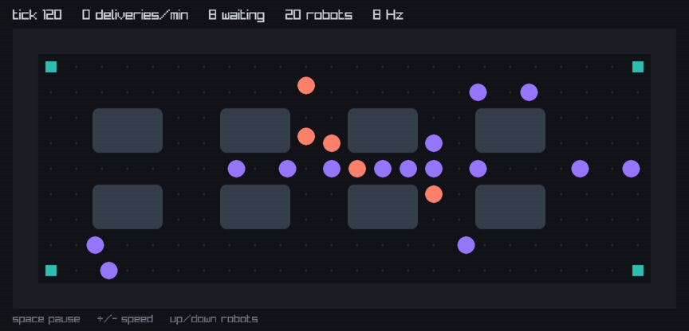

# warehouse-world



A grid warehouse where robots pick items from shelves and deliver them to
packing stations without colliding. The core is C++20 with no dependencies;
the optional graphical viewer uses [raylib](https://www.raylib.com).

```
#S...........le.........S#      lowercase  robot heading to a shelf
#..h.......j.............#      UPPERCASE  robot carrying an item
#..===..===..===..===....#      =          shelf
#........F.b.............#      S          packing station
#I.===.a===..===..===....#
#S.....................KS#
tick 40  robots 12  deliveries 11  moves 402  waits 77
```

## Build and run

Needs CMake 3.20+ and a C++20 compiler (on macOS: `xcode-select --install`,
`brew install cmake`).

```sh
cmake -S . -B build
cmake --build build -j
./build/ww_tests                         # run the tests
./build/warehouse                        # live view, Ctrl-C to quit
./build/warehouse --robots 20 --hz 15
./build/warehouse --map maps/small.txt --robots 6
./build/warehouse --headless --robots 16 --ticks 200000   # benchmark
```

### Graphical viewer

The viewer is opt-in, because configuring it downloads raylib 5.5 (pinned by
hash) on the first run.

```sh
cmake -S . -B build -DWW_VIEWER=ON
cmake --build build -j
./build/viewer                           # purple = to shelf, coral = carrying
./build/viewer --robots 24 --hz 15 --seed 3
./build/viewer --record docs/viewer.gif  # re-record the GIF above
```

Keys: <kbd>space</kbd> pause, <kbd>+</kbd>/<kbd>-</kbd> speed,
<kbd>↑</kbd>/<kbd>↓</kbd> robot count (restarts the run with the same seed).
The HUD shows the tick, deliveries per minute at the current speed (over
the last 10 s) and how many robots are blocked. On Linux, raylib also needs
the X11 and OpenGL development packages.

### In the browser (WebAssembly)

Needs [Emscripten](https://emscripten.org) (`brew install emscripten`, or
emsdk). Tests and the terminal app are skipped in this build.

```sh
emcmake cmake -S . -B build-web -DWW_VIEWER=ON
cmake --build build-web -j --target viewer
python3 -m http.server -d build-web 8000  # open http://localhost:8000/viewer.html
```

The output is `viewer.html`, `viewer.js` and `viewer.wasm`; any static file
host can serve them.

## How it works

| Piece | File | What it does |
|---|---|---|
| Grid | `grid.hpp` | Parses an ASCII map; knows walls, shelves, stations, pick faces |
| ECS | `ecs.hpp` | Sparse-set component pools; dense arrays, O(1) add/remove |
| Random | `random.hpp` | Portable Fisher–Yates shuffle and uniform ints on `mt19937_64` |
| Fixed timestep | `timestep.hpp` | Accumulator loop: sim ticks at a constant rate, independent of frame rate, with a catch-up cap |
| Movement | `systems.cpp` | One cell per tick along a cached BFS distance field; reservation rule prevents overlaps and head-on swaps |
| A* | `astar.hpp` | Single-robot shortest path (Manhattan heuristic, deterministic ties); the base for space-time planning |
| Tasks | `systems.cpp` | Shelf face → station → new task; counts deliveries |
| Viewer | `apps/viewer.cpp` | raylib window or WebAssembly page; robots move smoothly between cells using `FixedTimestep::alpha()` |
| Simulation | `simulation.hpp` | Owns the world, runs systems in order, validates invariants |

Same seed, same run: the simulation is fully deterministic, on every
platform.

## Phase 1 baseline (local collision avoidance only)

Deliveries in 20,000 ticks on the default map, over seeds 1–5
(`scripts/bench.sh`):

| Robots | 4 | 8 | 12 | 16 | 20 | 24 | 28 | 32 | 40 |
|---|---|---|---|---|---|---|---|---|---|
| Mean | 1872 | 3624 | 4029 | 4545 | 4037 | 3638 | 1973 | 1283 | 985 |
| Min-max | 846-2223 | 3592-3683 | 3818-4390 | 4349-4645 | 3011-4561 | 1920-4289 | 310-3750 | 146-2475 | 631-1872 |

Throughput peaks around 16 robots and then collapses, and past 20 robots
the outcome swings widely with the seed. Each robot plans alone and only
reacts to its neighbours, so crowded aisles gridlock. Fixing that is the
point of phase 2.

Earlier versions of this table used `std::shuffle` and
`std::uniform_int_distribution`, which differ between standard libraries;
the RNG is now portable (`random.hpp`), so these numbers reproduce anywhere.

## Roadmap

- [x] **Phase 1, core engine:** grid, ECS, fixed timestep, collision-free local movement, terminal view, tests
- [x] **Graphical viewer:** raylib, desktop and WebAssembly
- [ ] **Phase 2, warehouse brain:** A*, space-time A* with reservations, conflict-based search (CBS), smarter task assignment; beat the baseline above
- [ ] **Phase 3, authoritative server:** sim runs as a server, streams state over TCP at a fixed tick rate; viewer and order-injection clients
