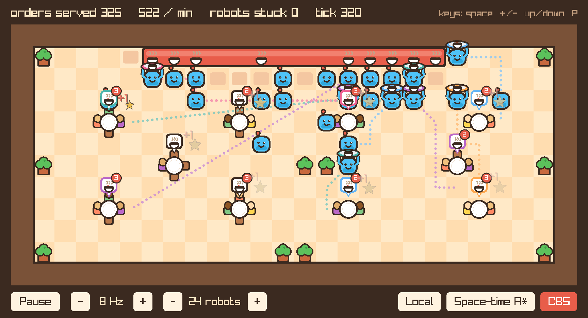

# Vision: Rush Hour Café

The engine stays a general multi-agent path finding (MAPF) simulator: grid,
planners, reservations, deterministic ticks. Its showcase becomes an
interactive game, **Rush Hour Café**, where robot waiters carry orders from
the kitchen to tables during a lunch rush.

## Same engine, new names

| Café | Engine today |
|---|---|
| Kitchen counter | Shelves and their pick faces (pickup) |
| Table | Station (drop-off) |
| Walls, plants, pillars | Obstacles |
| Orders served per minute | Deliveries per minute |

One kitchen counter along one wall makes a natural bottleneck: every order
starts at the same few cells. That's where robots crowd, so the difference
between planners is easy to see.

## Look and feel

Cozy console-game style, all original art.

- Chunky dark outlines (`#3B2A20`) and a checkered warm floor (`#FFE9C7` / `#FFDDB0`).
- Red kitchen counter (`#E85D4A`), white round tables, potted plants (`#5CC15C`) as obstacles.
- Robot waiters: rounded blue bodies (`#4FC3F7`) with eyes, a smile and an antenna; a plate of food sits on top while carrying.
- Customers show an order bubble above their table while they wait.
- Juice: a small hop on each move, a ding and a star pop on delivery, and an order bubble that wobbles once it has waited too long.
- HUD wording: "orders served", "robots stuck".

## Game loop

A lunch-rush timer, an orders-served counter, and a 1–3 star rating at the
end of each round.

## Planned features

- Map editor: place tables, walls and plants.
- One-way aisle arrows.
- Planner buttons: Local / Space-time A* / CBS.
- Challenge levels: "serve N orders in T ticks with R robots".
- Runs in the browser via WebAssembly.

## Order of work

A* ✅ → space-time A* with planner buttons ✅ → CBS → café theme + map
editor → one-way aisles → challenge levels → web deploy.

The theme comes after CBS; until then the visuals stay as they are.
