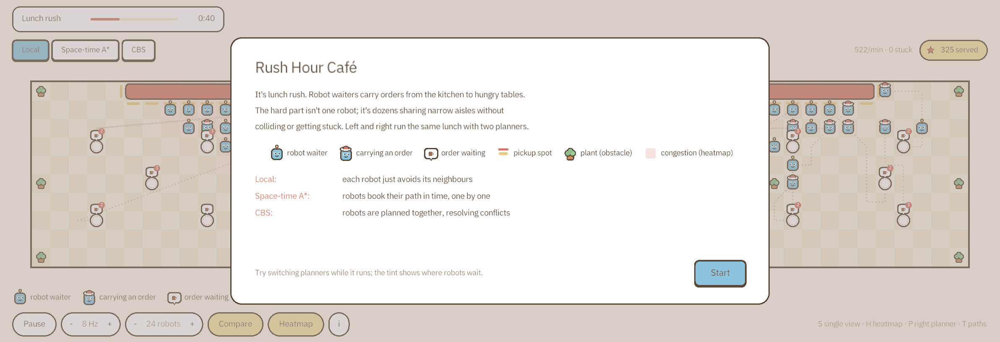

# Vision: Rush Hour Café

The engine stays a general multi-agent path finding (MAPF) simulator: grid,
planners, reservations, deterministic ticks. Its showcase becomes an
interactive game, **Rush Hour Café**, where robot waiters carry orders from
the kitchen to tables during a lunch rush.

## Same engine, new names

| Café | Engine today |
|---|---|
| Kitchen counter | Shelves and their pick faces (pickup) |
| Table | Station (drop-off) |
| Walls, plants, pillars | Obstacles |
| Orders served per minute | Deliveries per minute |

One kitchen counter along one wall makes a natural bottleneck: every order
starts at the same few cells. That's where robots crowd, so the difference
between planners is easy to see.

## Look and feel

Cozy café, toned down: warm and light, but not loud. Soft brown outlines,
small shapes with room around them, no shadows or gradients.

| Element | Look |
|---|---|
| Lines | soft brown `#5A4636`, ~1.5 px (2 px for the floor frame) |
| Page / floor | `#FBF4E9` / a very faint checker `#FAF2E6` and `#F4E8D6` |
| Kitchen counter | muted coral `#D27A68` with "Kitchen" in white; pickup spots are thin `#EBCB82` mats along its edge |
| Tables | white, thin outline, faint dashed rim `#E9C7C0`, ~60% of a cell |
| Plants | leaves `#8FC08A` / `#9CCB96`, pots `#C98B63`, ~55% of a cell |
| Robots | dusty blue `#8CC4E0`, ~50% of a cell |
| Food and badges | coral `#D27A68`; cups `#9A6B4F`; star and served badge `#F6DFA0` |

- **Robot waiters:** rounded squares with two eyes (white, small brown
  pupils that look the way they're going), a small smile and a short
  antenna with a `#EBCB82` tip. Carrying: a white plate with a coral dish on
  top, about the robot's width, and no antenna.
- **Orders:** a small white speech bubble with a brown cup above a table
  with a waiting order, and a small coral number badge for more than one.
- **Flow:** every carrying robot has a faint dotted brown line that ends at
  the edge of the table it's serving, under that table's bubble.
  Hover or click a robot, or press T, for full planned paths.
- **Delivery:** the bubble pops away and a small "+1" floats up.
- **Legend:** one line under the floor with a tiny drawn icon for robot
  waiter, carrying an order, order waiting, pickup spot and plant.
- **HUD:** a "Lunch rush" panel (thin coral progress bar and time) on the
  left, a pale yellow "★ N served" badge on the right. Along the bottom,
  small pills (pause, speed, "N stuck", "N robots") and planner buttons with
  a 1.8 px outline and a thicker bottom edge; the active one is filled blue.
- **Intro card:** on launch, a white card over the dimmed, paused café:
  the title, a short story, the legend, one line per planner and a Start
  button. The "i" pill reopens it.
- Font: IBM Plex Sans (SIL Open Font License), committed in `assets/fonts/`.

## Game loop

A lunch-rush timer, an orders-served counter, and a 1–3 star rating at the
end of each round.

## Planned features

- Comparison mode: two planners side by side on the same map and seed, a
  congestion heatmap, and a hover card per robot.
- Map editor: place tables, walls and plants.
- One-way aisle arrows.
- Challenge levels: "serve N orders in T ticks with R robots".
- Runs in the browser via WebAssembly.

## Order of work

A* ✅ → space-time A* ✅ → CBS ✅ → café look and map ✅ → space-time A*
clearance fix ✅ → comparison mode → map editor → one-way aisles →
challenge levels → web deploy.
